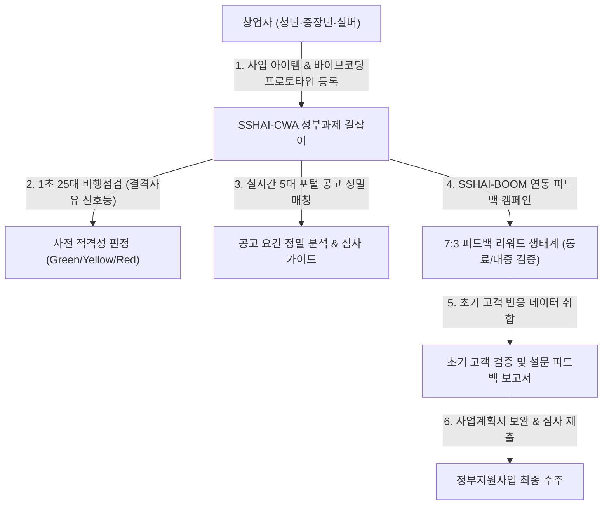
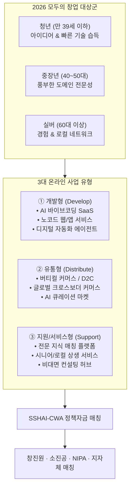
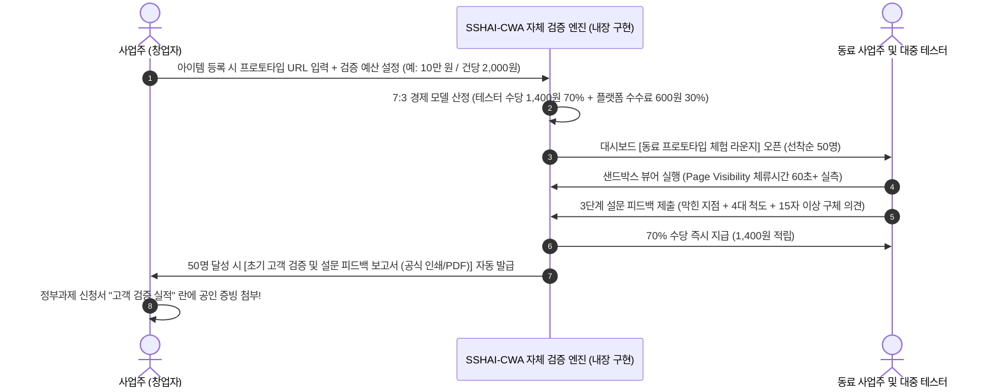
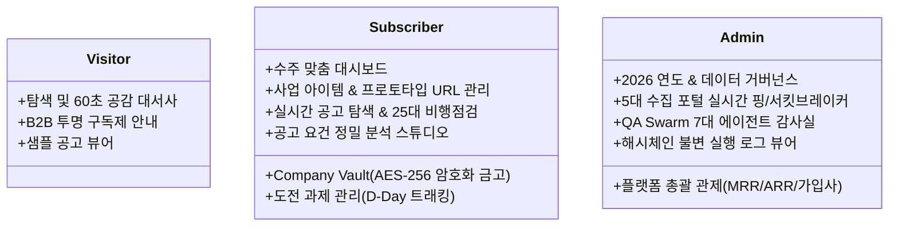
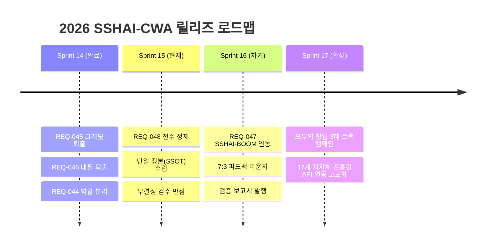

# [SSOT] 대한민국 AI 정부과제 매칭 & 바이브코딩 검증 플랫폼 단일 기획 정본

> **문서 상태**: 공식 확정 정본 (Single Source of Truth)  
> **수립 일자**: 2026-10-28  
> **총괄 아키텍트**: Gemini Chief Work Agent (GCWA)  
> **공동 합의**: 7대 전문 분과위원회 (CPO, UI/UX, BM엔진, DB/보안, 수집/인프라, QA Swarm, QQAQC)  
> **적용 대상**: `SSHAI-CWA` 전 모듈, 프론트엔드 템플릿(16종), DB 스키마, `SSHAI-BOOM` 연동 규격  

---

## Executive Summary: 플랫폼 본질과 정체성 선언

> **우리는 무엇인가?**  
> 대한민국 공공 과제(창진원, 소진공, NIPA, 지자체 진흥원 등)를 준비하는 창업자를 위한 **"AI 정부과제 매칭 및 요건 분석 길잡이(AI Grant Navigator)"**이자, AI 바이브코딩 개발물의 **"초기 고객 반응 검증 허브"**이다.

> **우리는 무엇이 아닌가? (엄격한 금지 원칙)**  
> 1. ❌ **사업계획서 대필 서비스가 아니다.** (공고 요건 및 심사기준별 작성 체크포인트 가이드만 제공)  
> 2. ❌ **게임식 코인/크레딧 및 생성 횟수 과금사가 아니다.** (아이템 등록 수, 공고 매칭, 바이브코딩 실증 캠페인, 5대 전문 파트너 전담 배정 기반의 정규 B2B 멤버십 체계)  
> 3. ❌ **선정 확률을 보장하지 않는다.** (객관적 25대 결격사유 사전 검증 및 수주 경쟁력 진단)  
> 4. ❌ **사업자 화면에 플랫폼 매출(MRR/ARR)을 노출하지 않는다.** (플랫폼 매출은 관리자 전용)  

---

## 제1장. 과거 할루시네이션 원인 분석 및 영구 박멸 내역

초기 프로토타입 단계에서 발생했던 4대 할루시네이션의 근본 원인을 분석하고, 전 코드베이스와 템플릿에서 완전히 정제·퇴출된 상태를 확정한다.

| 번호 | 과거 할루시네이션 잔재 | 발생 원인 | 정제 및 단일 정본(SSOT) 환원 규격 | 상태 |
|:---:|:---|:---|:---|:---:|
| **01** | **사업계획서 대필 / 초안 작성** (`새 계획서 작성`, `15분 초안 완성`, `초안 작성 중...`) | 해외 생성형 LLM 래퍼의 과장 마케팅 문구를 무비판적으로 차용함 | **`맞춤 공고 탐색`**, **`공고 요건 정밀 분석`**, **`심사 기준별 대응 가이드 도출`**로 100% 환원. AI는 평가 기준과 필수 항목을 1:1 대조해 주는 길잡이 역할에 집중. | ✅ 완결 (REQ-046, REQ-048) |
| **02** | **게임 머니식 크레딧 및 생성 횟수 과금** (`잔여 크레딧 350회`, `fa-coins`, `월간 생성 한도 350회`) | B2C 모바일 토큰 및 생성형 AI 텍스트 토큰 과금 모델을 B2B 정부과제 솔루션에 오적용함 | **`등록 아이템 관리 한도`**, **`공고 매칭 & 결격진단`**, **`바이브코딩 실증 캠페인 & 7:3 리워드 피드백`**, **`5대 전문 파트너 자문 배정`** 기반의 정규 B2B 멤버십 체계로 100% 개편. 텍스트 토큰 과금 개념 완전 퇴출. | ✅ 완결 (REQ-045, REQ-049) |
| **03** | **선정/합격 확률 과장** (`선정 확률 극대화`, `선정 확률 100%`) | 주관적 심사 영역을 AI가 보장하는 듯한 과장 표현 | **`수주 경쟁력 극대화`**, **`공고 요건 정합도 진단`**, **`25대 비행점검 신호등 통과율`**로 객관화. 결격 사유 제거 및 가점 획득 전략에 집중. | ✅ 완결 (REQ-048) |
| **04** | **사업자 화면 내 운영사 매출 노출** (`MRR`, `ARR`, `플랫폼 순수익`, `활성 기업수`) | 사업자(Subscriber)와 플랫폼 관리자(Admin)의 권한 및 대시보드 경계 미분리 | 사업자 화면은 **`사업주 4대 수주 KPI`**(적합 공고 수, 도전 과제 수, 최대 획득 지원금, 금고 완성도)로 재구축. 플랫폼 매출 통계는 **`/admin` 관리자 전용**으로 완전 격리. | ✅ 완결 (REQ-044) |

---

## 제2장. 2026 국가 창업 기조 전환: "모두의 창업" & 3대 온라인 사업 모델

2026년부터 중소벤처기업부 및 창업진흥원의 예비창업패키지가 **"모두의 창업"**으로 전면 전환된다. AI 혁명으로 촉발된 고용 구조 변화 속에서, 본 플랫폼은 취업 취약 계층이 스스로 자립할 수 있도록 돕는 나침반 역할을 수행한다.

### 1. 3대 창업 계층별 특화 지원
- **청년층 (만 39세 이하)**: 청년 전용 가점(+2점) 및 청년창업사관학교, 창창패 집중 공략. 바이브코딩 기반 디지털 신사업 육성.
- **중장년층 (40~50대)**: 풍부한 현업 경력을 바탕으로 한 B2B SaaS, 솔루션 유통, 전문 서비스 창업. 신사업창업사관학교 및 중장년 기술창업센터 과제 연계.
- **실버층 (60대 이상)**: 전통 로컬 유통 및 상생 컨설팅 모델. 스마트 소상공인 바우처 및 로컬크리에이터 정책자금 매칭.

### 2. 3대 온라인 사업 유형별 매칭 엔진
1. **개발형 (Develop)**: 정보통신산업진흥원(NIPA) AI 바우처, 과기정통부 SW고성장클럽, 중기부 딥테크 팁스(TIPS).
2. **유통형 (Distribute)**: 소상공인시장진흥공단(소진공) e-커머스 판로개척 지원, KOTRA 수출바우처, 스마트 유통물류 혁신 과제.
3. **지원/서비스형 (Support/Service)**: 중기부 비대면 서비스 바우처, 지자체 지역특화산업 육성, 사회적기업가 육성사업.

---

## 제3장. 바이브코딩 프로토타입 검증 & 네이티브 피드백 경제 (자매 기획 자산의 자체 구현)

> **[핵심 원칙 확정]**: SSHAI-BOOM은 외부 별도 서비스와의 API 연동이 **아니다**.  
> 사용자 대표님의 지시에 따라, 과거 기획·개발된 SSHAI-BOOM의 핵심 설계 자산(체류 시간 검증 하트비트 엔진, 3단계 구조화 피드백, 7:3 리워드 정산 모델, 심사위원 제출용 검증 보고서)을 **본 플랫폼(SSHAI-CWA) 내부에 직접 네이티브 모듈로 구현하여 서비스**한다.

AI 코딩 어시스턴트(Cursor, Lovable, v0, Bolt 등)의 보급으로 누구나 며칠 만에 웹/앱 프로토타입을 제작(Vibe Coding)하는 시대가 도래했다. 그러나 **정부지원사업(2026 모두의 창업 등) 심사위원들은 "실제 고객의 사용 반응과 검증 데이터"를 최소한의 필수 사업 성과로 요구**한다.

### 1. 자체 내장 구현 모듈 상세 (SSHAI-BOOM 기획 자산의 내재화)
1. **체류 시간 검증 엔진 (Page Visibility Engine)**:
   - `document.visibilityState` 및 3초 간격 세션 하트비트를 통해 브라우저 탭 활성 시간을 초 단위로 실측.
   - 탭 이탈이나 화면 숨김 시 타이머 즉시 정지 (`isPaused: true`).
   - 60초 미만은 무효(체리피커 방어), 60초 이상 실사용 시에만 피드백 제출 자격 부여.
2. **3단계 구조화 피드백 설문 모델**:
   - **Step 1 (사용성 & 첫인상)**: 핵심 막힌 지점 Top 1 (로그인, UI 깨짐, 기능 오류, 속도 지연 등).
   - **Step 2 (정량 평가)**: UX 편의성(1~5), 기능 완성도(1~5), 지불 용의성(1~5), NPS 순추천지수(1~10).
   - **Step 3 (정성 평가)**: 심사위원이 지적할 만한 취약점 및 개선 아이디어 (15자 이상 필수 입력).
3. **7:3 유료 피드백 리워드 정산 경제**:
   - 사업주가 책정한 한도 예산(예: 10만 원) 내에서 선착순 모집(50명).
   - 피드백을 정상 제출한 참여자에게 **건당 한도 금액의 70%(1,400원) 개별 지급**.
   - **30%(600원)는 당사 플랫폼 운영 및 보고서 발급 수수료**.
   - 선착순 완료 시 캠페인 자동 종료.
4. **심사위원 제출용 "초기 고객 검증 및 설문 피드백 보고서" (`/prototype/report/{id}`)**:
   - 테스터 모수(N=50), 평균 실사용 체류 시간, 5대 평가 지표 방사형 차트, 막힌 지점 통계.
   - 심사위원 대응 보완 계획서, 데이터 위변조 방지 SHA-256 감사 해시 날인.
   - 정부과제 사업계획서 "시장 반응 및 고객 검증 실적"에 원클릭 첨부 지원.

---

## 제4장. 3대 사용자 권한 체계 & 16대 전 화면 매핑 매트릭스

사용자 피드백(*"사업자와 관리자 화면이 서로 엇갈려 있는 것 같다"*)을 완벽히 수렴하여, 3대 페르소나별 접근 가능한 화면과 메뉴를 엄격히 분리·재정렬하였다.

### 전 화면(16종) 기능 및 역할 매핑 표

| 구분 | 화면 경로 (`URL`) | 템플릿 파일 | 핵심 제공 가치 및 기능 | 접근 권한 |
|:---:|:---|:---|:---|:---:|
| **방문자** | `/intro` | `intro.html` | 60초 5막 공감 대서사 (창업 피로→25대 검증→요건분석→수주→성장 파트너 & 프로토타입 체험/7:3 리워드 라운지) | 비로그인 / 전원 |
| **방문자** | `/pricing` | `pricing.html` | B2B 투명 멤버십 플랜 (Free / Growth / Scale-Up / Agency) 및 아이템/매칭 혜택 안내 | 비로그인 / 전원 |
| **방문자** | `/matches` | `matches.html` | 실시간 수집 공고 샘플 뷰어 (상세 열람 시 블러 페이월 안내) | 비로그인 / 전원 |
| **사업자** | `/dashboard` | `biz_dashboard.html` | **사업주 4대 수주 KPI**, 5대 BM 맞춤 인사이트, 공고 레이더, 프로토타입 실증 캠페인 연동 | 유료 사업자 |
| **사업자** | `/items` | `items.html` | **사업 아이템 CRUD**, 바이브코딩 프로토타입 URL 등록, 사업 소개자료 자동 파싱 Auto-fill | 유료 사업자 |
| **사업자** | `/vault` | `vault.html` | **Company Vault**: 4대 핵심 자산(IR덱, 특허, 재무제표, 사업소개서) AES-256 격리 보관 | 유료 사업자 |
| **사업자** | `/announcements` | `announcements.html` | 2026 전국 공고 실시간 검색, 지자체/기관별 필터링, 상세 모달 | 유료 사업자 |
| **사업자** | `/projects` | `projects.html` | 도전 과제 파이프라인, 마감 D-Day 실시간 카운트다운, ics 캘린더 연동 | 유료 사업자 |
| **사업자** | `/proposals/tailor`| `tailor.html` | **공고 요건 정밀 분석 스튜디오**: 심사 기준별 1:1 대조 및 전략 대응 가이드 | 유료 사업자 |
| **관리자** | `/admin` | `admin_platform.html` | **운영사 전용 총괄 관제**: MRR, ARR, 유료 기업 수, 테넌트 멤버십 모니터링 | 슈퍼 어드민 |
| **관리자** | `/governance` | `governance_partner.html` | 2026 연도별 공고 거버넌스, 지자체 정책 가중치, 데이터 정합성 관리 | 관리자 |
| **관리자** | `/portals` | `portals.html` | 5대 수집 포털(K-Startup, NTIS 등) 실시간 핑, 서킷브레이커 상태 제어 | 관리자 |
| **관리자** | `/audit` | `audit.html` | QA Swarm 7대 전문 검수단 원클릭 감사 및 140점 만점 시각화 대시보드 | 관리자 |
| **관리자** | `/logs` | `logs.html` | 시스템 실시간 실행 로그 뷰어, SHA-256 해시체인 무결성 검증, 보고서 다운로드 | 관리자 |

---

## 제5장. 기술 아키텍처 및 보안 원칙

### 1. 25대 비행점검(Preflight Checks) 엔진
공고 지원 전 1초 만에 25개 결격사유를 검증하여 탈락을 예방한다:
- **재무 건전성**: 최근 2년 연속 자본잠식률, 부채비율 500% 초과 여부 (창업 3년 미만 특례 자동 판정).
- **행정 제재**: 국세·지방세 체납 여부, 국가 R&D 과제 참여제한 제재 이력.
- **과제 중복성**: 동점 유사 사업 중복 수혜 여부, 3책 5공(최대 참여 연구과제 수) 저촉 여부.
- **자격 요건**: 대표자 연령(청년 가점), 여성기업/사회적기업/이노비즈 인증 여부, TRL(기술성숙도) 부합도.

### 2. Zero-Retention 무보관 원칙 & AES-256-GCM 암호화
- **무보관 원칙**: 업로드된 사업계획서 원문 파일은 파싱 즉시 메모리에서 소멸되며 서버 디스크에 평문으로 영구 보관되지 않는다.
- **Company Vault 격리**: 테넌트별 독립적인 `tenant_salt`와 HKDF-SHA256 파생키를 통해 AES-256-GCM 대칭키로 암호화 보관.

### 3. K-Horizon 2027 디자인 시스템 & 카파시 4원칙
- **디자인 무결성**: 인라인 정적 스타일(`style="..."`) 100% 배제. 오직 `design_system.py`와 `k_horizon_2027.css`의 토큰 클래스만 사용.
- **카파시 4원칙 준수**:
  1. 단순하고 예측 가능한 코드 (하드코딩 제거, `constants.py` SSOT화).
  2. 철저한 오류 격리 (`try-except` 파이프라인 방어).
  3. 로컬 우선 경량화 (오프라인 모드 100% 작동 보장).
  4. 타협 없는 증거 기반 검증 (Pytest 251+ pass, QA Swarm 140/140 배포 승인).

---

## 제6장. 향후 마일스톤 및 릴리즈 로드맵

1. **Sprint 15 (현재)**:
   - REQ-048 잔여 할루시네이션 발본색원 전수 정제 및 단일 정본(SSOT) 수립 (완료).
2. **Sprint 16 (차기 마일스톤)**:
   - REQ-047: `SSHAI-BOOM` 실시간 연동, `items.html` 프로토타입 URL 입력 필드, `biz_dashboard.html` 7:3 피드백 리워드 라운지 구축.
3. **Sprint 17 (생태계 확장)**:
   - 2026 "모두의 창업" 맞춤형 3대 온라인 사업 유형(개발/유통/지원) 전용 공고 필터 및 바이브코딩 검증 보고서 HWPX/PDF 자동 합성.

---

> 본 정본 문서는 향후 모든 개발 작업(QCWA), 품질 검수(QQAQC), 기획 의사결정의 최상위 기준 문서로 기능하며, 허위 약속이나 모호한 통계 표현의 재발을 원천 차단한다.
